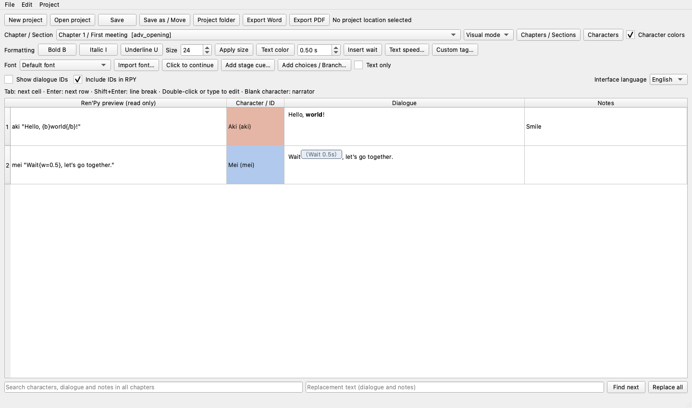

# Ren’Py Text Editor

**Write visual novel dialogue in a table, preview formatting as you type, and export clean Ren’Py scripts.**

Ren’Py Text Editor is an offline desktop application for writers who want to focus on characters, dialogue and notes. It uses Python, PySide6 and SQLite, with portable builds for **Windows x64** and **macOS Apple Silicon**.

**Interface languages:** English · 日本語 · 简体中文 · 繁體中文

[Download releases](https://github.com/akihium/renpy-text-editor/releases) · [繁體中文指南](docs/quickstart.zh-TW.md) · [简体中文指南](docs/quickstart.zh-CN.md) · [日本語ガイド](docs/quickstart.ja.md) · [English guide](docs/quickstart.en.md)



## Features

- Four-column editor: read-only Ren’Py preview, character, dialogue and notes.
- Keyboard navigation: Tab / Shift+Tab, Enter for the next dialogue, Shift+Enter for a line break, formatting and undo shortcuts.
- Visual and source-tag modes, with bold, italic, underline, font size, color and imported fonts.
- Click-to-continue, timed waits, text speed and preserved custom tags.
- Character names/colors and safe character ID renaming with automatic reference updates.
- Chapters and sections: add, rename, duplicate, reorder, delete and merge.
- Background changes, show/hide cues, transitions, branching choices and jump/call/return.
- Text-only view to hide stage cues while editing dialogue.
- SQLite projects, autosave, asset-aware backups and search/replace.
- Ren’Py `.rpy`, Excel, Word and PDF output; custom document titles and optional exported dialogue IDs.
- Four localized demo sets, included in both application packages.

## Download and run

Get the latest package from [Releases](https://github.com/akihium/renpy-text-editor/releases).

| Platform | Package | Launch |
| --- | --- | --- |
| Windows 10/11 x64 | `RenPy-Text-Editor-Windows-x64.zip` | Extract the whole folder, then open `RenPy Text Editor.exe` |
| macOS 14+ Apple Silicon | `RenPy-Text-Editor-macOS-arm64.zip` | Extract the folder, then open `RenPy Text Editor.app` |

The executable depends on the other files in the package. **Keep the whole extracted folder.** These are portable builds; no paid developer signing certificate or macOS notarization is applied.

Open an example under `examples/en`, `examples/ja`, `examples/zh_CN` or `examples/zh_TW`. Each language includes `sample.advdb`, `branches.advdb`, matching Excel examples, assets and an exported Ren’Py example. Use Save as before modifying a bundled demo.

When moving your own project, keep `name.advdb` together with `name_assets/`. The app copies imported fonts and images there, and includes them when saving elsewhere or exporting to Ren’Py. No cloud service or account is needed to run the app.

## Run from source

Use **Python 3.11–3.14**, with Python **3.12** recommended. Install dependencies once; the app runs offline afterward.

macOS:

```sh
python3.12 -m venv .venv
.venv/bin/python -m pip install -r requirements.txt
.venv/bin/python main.py examples/localized/ja/branches.advdb
```

Windows PowerShell:

```powershell
py -3.12 -m venv .venv
.venv/Scripts/python.exe -m pip install -r requirements.txt
.venv/Scripts/python.exe main.py examples/localized/en/branches.advdb
```

If an iCloud folder marks Qt plugins as hidden on macOS, use `zsh scripts/run_macos.sh`.

## Ren’Py integration

Export to your game's `game` folder. Generated files live under `adv_generated/`, leaving handwritten stage scripts separate.

```renpy
label start:
    call adv_opening
    return
```

The **Include IDs in RPY** switch controls explicit `id d_...` clauses. Permanent editor IDs stay in the project either way. Changing section or character IDs updates project references; handwritten external scripts must be updated separately.

This app is not a Ren’Py engine or SDK. Run Ren’Py Lint and play-test your game after exporting, especially when using custom tags or handwritten image definitions. Ren’Py is a separate project and does not endorse this editor.

## Build and test

```sh
# macOS
QT_QPA_PLATFORM=offscreen .venv/bin/python -m pytest -q
zsh scripts/build_macos.sh
```

```powershell
# Windows
$env:QT_QPA_PLATFORM = 'offscreen'
.venv/Scripts/python.exe -m pytest -q
./scripts/build_windows.ps1
```

Builds must run on the target OS; PyInstaller is not a cross-compiler. The GitHub Actions **Build and publish** workflow builds both platforms, tests the code, runs the frozen application's export checks, and publishes release assets only after both builds succeed. `scripts/checksums.py` generates SHA-256 checksums. Source code is versioned in Git; binaries are attached to Releases.

To reproduce a frozen-app export check:

```text
<app executable> --verify-exports <empty output directory>
```

## Current scope

This is an MVP with basic stage cues and branching, not a full game engine, animation timeline or conditional-choice editor. Unknown text tags are preserved as visual markers. Word records font family names without embedding fonts; PDF embeds supported local fonts and falls back when a format is unsupported. Font coverage depends on the fonts installed or imported on the computer.

## License and contributions

Original application source and authored examples: **[MIT](LICENSE)**. Third-party libraries have separate licenses; see [notices](THIRD_PARTY_NOTICES.md) and the `LICENSES` folder in binary packages. Operating-system fonts and personal project files are not included.

Bug reports and pull requests are welcome. Include the OS, app version, steps to reproduce and a small non-private example when possible. See [CONTRIBUTING](CONTRIBUTING.md).
